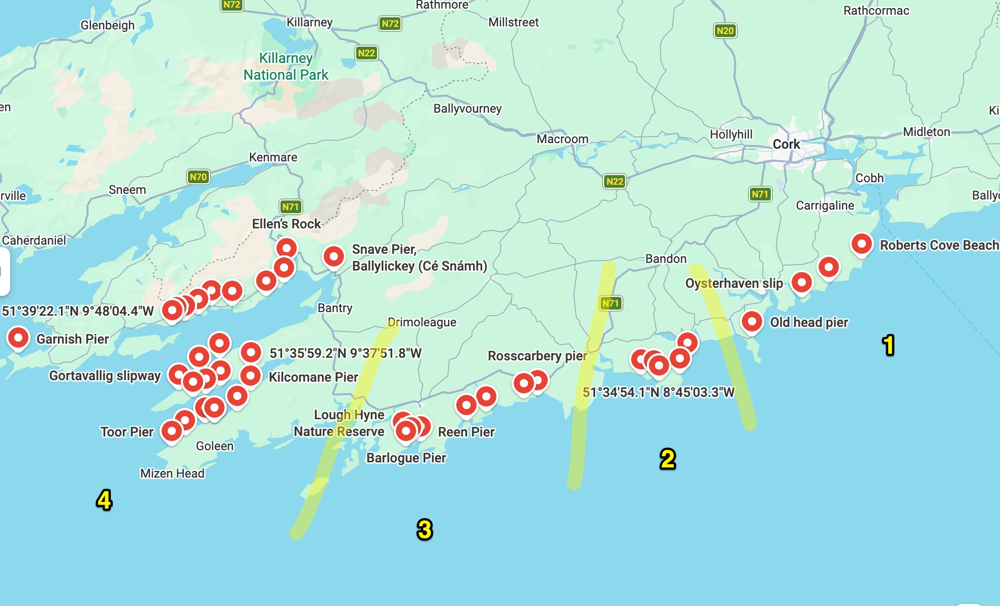

# Shore diving in West Cork

Notes for exploring shore dives from piers, slips and beaches in West Cork. Pier locations come from the [eOceanic Cork harbours guide](https://eoceanic.com/sailing/harbours/europe/ireland/cork/).

## Contents

| File | What it is |
|---|---|
| [`Cork_Shore_Diving_-_Google_Maps.jpg`](Cork_Shore_Diving_-_Google_Maps.jpg) | Map of the shore spots, split into 4 zones (see [Zones](#zones)) |
| [`eOceanic/`](eOceanic/README.md) | Data for all 91 eOceanic Cork locations (JSON and CSV), the saved pages, and the scripts that fetch and extract them. For cross-referencing with the [`Takeout/`](Takeout/Cork_Shore_Diving.csv) list |
| [`question.txt`](question.txt) | Draft message for a poll on weekend shore diving: which days, times and distances suit best |
| [`Flutter kick.jpg`](Flutter%20kick.jpg), [`Frog Kick.jpg`](Frog%20Kick.jpg) | Sketches of the two kicks, for [finning](#finning) |

## Zones

The local shore spots are split into 4 zones on the map, based on drive time from Cork city. Zone 1 is the closest and zone 4 the furthest.

Spots named on the map, read from the screenshot (zone boundaries are approximate):

| Zone | Spots labelled on the map |
|---|---|
| 1 | Roberts Cove Beach, Old Head pier, Oysterhaven slip |
| 2 | A cluster of unlabelled pins around Seven Heads |
| 3 | Lough Hyne Nature Reserve, Barlogue Pier, Reen Pier, Rosscarbery pier |
| 4 | Snave Pier (Ballylickey), Ellen's Rock, Kilcomane Pier, Toor Pier, Gortavallig slipway, Garnish Pier |

The map has many more pins than labels. Three pins carry only coordinates: 51°34'54.1"N 8°45'03.3"W (near the Seven Heads pins, zone 2), 51°35'59.2"N 9°37'51.8"W and 51°39'22.1"N 9°48'04.4"W (both zone 4).

## Pier locations

The eOceanic page lists harbours and anchorages clockwise round the Cork coast. This is a selection of its mainland West Cork entries that mention a pier, slip or quay for landing, in eOceanic's order, not the complete list. Other entries with a pier or quay, such as Clonakilty Harbour (Ring), Crookhaven, Schull Harbour, Ballydehob Bay, Bantry Harbour and Ballycrovane Harbour, aren't included, and neither are the island entries. Open the page and use "get full information" on an entry for its full description.

| Location | Landing, per eOceanic | In my iNaturalist dive sites |
|---|---|---|
| Seven Heads Bay | Small pier and slip to land | Seven Heads Pier |
| Dunnycove Bay | Small slip with a path up to the road | |
| Dirk Bay | Slip on the west side of the bay | |
| Rosscarbery Inlet | Small pier; the inlet dries at low water | |
| Mill Cove | Small quay about halfway up the inlet | |
| Barloge Creek (Lough Hyne) | Adjacent pier for landings | Barloge Pier, Lough Hyne |
| Dereenatra | Tiny south-facing cove with a pier | |
| Colla Harbour | Modern pier that dries | |
| Dunmanus Harbour | Pier for landings, overlooked by a castle | |
| Dunbeacon Harbour | New quay and a nearby village | |
| Kitchen Cove | New pier and visitor moorings | |
| Kilcrohane Pier | Pier and slip, small village inland | Kilcrohane Pier |
| Dooneen Pier | Substantial pier, small village inland | Dooneen Pier |
| Ballynatra (Trá Ruaim) Cove | Pier and slip; open cove | |
| Adrigole | Pier on the eastern shore | Trafrask Pier is logged under Adrigole. I haven't checked that it is this pier |
| Garnish Bay | Quay with a slip and a beach | |

Some of my dive sites have no pier entry on eOceanic. Blind Strand Pier appears only as Blindstrand Bay, which mentions no pier. Snave Pier, Bank Pier, Zetland Pier, Gortdubh Pier and Aghabeg Pier aren't listed under those names.

## Limits of the eOceanic data

- eOceanic is written for boats. Its "metres LWS" figures are the depth at the anchorage at low water springs, not dive depth.
- Its access notes ("safe access", "careful navigation required") describe approaching by sea, not parking, walking to the water or entering and leaving the water on foot.
- It says nothing about visibility, currents, swell, marine life or whether diving is allowed at a given pier. Check local conditions and access for each site yourself.

## Finning

Sketches of the two kicks:

| Flutter kick | Frog kick |
|---|---|
|  |  |

## Related

- [`../iNaturalist/`](../iNaturalist/README.md) holds the iNaturalist scripts and reports for my underwater observations.
- [`../iNaturalist/Preferred_dive_site_names_ireland.txt`](../iNaturalist/Preferred_dive_site_names_ireland.txt) is the canonical list of dive site names used in those reports.
